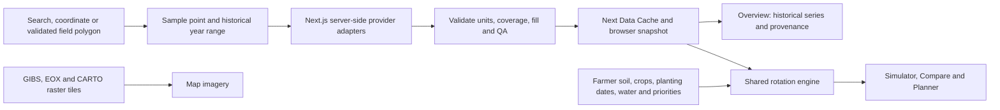

# Farm evidence and rotation model

## Starting point

Audit base `a901f2a` on `main`. This is a Next.js 16 App Router app with React, TypeScript, MapLibre, Recharts and a Zustand farm/rotation store. The landing page and setup lead to Overview, Simulator, Compare, Planner, Learn, Methodology and Settings. The browser and `POST /api/simulate` use the same deterministic engine. Vercel can build it as a standard Next.js site with Node route handlers. The repository had a demo engine smoke script and no automated provider normalization checks.

| Before the upgrade | Effect |
| --- | --- |
| Monthly NASA POWER response and demo snapshot | Numeric weather inputs drove evapotranspiration, effective rainfall and crop screening. Missing humidity, sunshine, wind and temperature range were silently replaced with constants. Live failures could generate synthetic regional climate. |
| Daily NASA POWER | Extreme-day counts informed charts, the risk calendar and the bare-soil exposure proxy. Missing days could depress counts. |
| ORNL MOD13Q1 | Numeric NDVI appeared in charts and evidence cards only. No quality bands were consulted and the request could exceed the route budget. |
| NASA GIBS, EOX and CARTO | Displayed imagery and basemaps. No tile pixels entered the engine. |
| ISRIC and farmer profile | SoilGrids REST supplied an optional estimate when reachable. User-entered profile informed calculations. The bundled demo profile is illustrative. |
| SMAP and IMERG | Both existed as imagery overlays only. POWER `GWETROOT` is a MERRA-2 wetness fraction and `PRECTOTCORR` is POWER corrected rainfall. |
| Scenario defaults | One default replicated current practice. The app already shared preview state. Crop overlap warnings missed some multi-crop combinations. |

Implementation order was complete-year POWER validation and missing-data handling, QA-screened MODIS, public numeric water products, evidence panels, then calendar and rotation comparison. The challenge title resolves to [Field Shift: Adapting Farms with NASA Data](https://www.spaceappschallenge.org/2026/challenges/field-shift-adapting-farms-with-nasa-data/). Its Resources tab could not be fetched from the test environment. The matrix uses the primary provider references below.

## Data flow

A drawn field supplies an interior point and approximate area. The adapters sample the point. They do not compute a polygon-wide statistic. Cache identity includes adapter contract version, point rounded to five decimals, variables and period. Normalized successful results use the Next Data Cache, with a 12-hour revalidation window. Concurrent requests coalesce within a worker and in the browser. The app preserves the retrieval date, marks data from cache and can reuse the same request's cached evidence on outages or in offline mode. A bundled Thới Lai snapshot can also support the demo without live access. Upstream failures use bounded timeouts, one transient retry with jitter, and Retry-After handling when it fits the budget. Structured warning logs include product and failure class. They omit coordinates and raw upstream errors.

## Dataset matrix

| Product | Access, coverage and timing | Resolution and units | App use and status |
| --- | --- | --- | --- |
| NASA POWER MERRA-2 / CERES monthly | Public [POWER monthly point API](https://power.larc.nasa.gov/docs/services/api/temporal/monthly/), AG JSON. Global. Model window begins no earlier than 1984 and ends before the current year. | Weather 0.5° × 0.625°, solar approximately 1°. °C, %, m/s, MJ/m²/day and mm/day multiplied by calendar days for monthly totals. GWET ratios are a separate modeled wetness chart. | Live numeric source at `/api/climate`. Temperature, range, humidity, wind, radiation, elevation, and fallback rainfall. Missing required variables exclude their year. POWER archive files include retrieval and API version where available. |
| NASA POWER daily weather | Public [POWER daily point API](https://power.larc.nasa.gov/docs/services/api/temporal/daily/), AG JSON, default local solar time. Same complete-year selection. | 0.5° × 0.625°, mm/day and °C. | Live at `/api/climate-daily`. Counts heavy rain, heat and frost. Heavy rain informs the bare-soil proxy. Incomplete calendar years are excluded. |
| NASA GPM IMERG | Public [POWER daily point API](https://power.larc.nasa.gov/docs/methodology/data/sources_meteorology/) with `IMERG_PRECTOT`, AG, UTC. NASA's latest availability varies by run and provider. App bounds selection to 2001 onward and complete calendar years. | 0.1° × 0.1° (~10 km), daily mm summed only when every day of a month is present. | Live at `/api/imerg`. Response must identify `IMERG` and UTC. Replaces POWER rainfall only when every model month has coverage. POWER's response does not publish the IMERG run, collection, or pixel QA. See [NASA GPM product documentation](https://gpm.nasa.gov/data/imerg). |
| NASA SMAP L4 via POWER | Public [NASA POWER monthly Zarr](https://nasa-power-smap.s3.amazonaws.com/smap/temporal/power_smap_monthly_temporal_utc.zarr/.zmetadata), metadata and two point-containing chunks over HTTPS. Global land within approximately ±84.66°, since April 2015. Dataset availability lags acquisition. | Native ~9 km, distributed on POWER grid. Monthly `SFMC` (0–5 cm) and `RZMC` (0–100 cm) in m³/m³. Count valid values and report archive version. Per-pixel QA and original NSIDC collection number are not published in these chunks. | Live at `/api/smap`. Numeric satellite-assimilated estimates. The wettest months can add a drainage warning after at least three samples per calendar month. No calibration of irrigation volume from SMAP. May–July 2026 excluded per [NSIDC advisory](https://nsidc.org/data/spl4smgp/versions/8). |
| NASA MODIS Terra MOD13Q1.061 | Public [ORNL TESViS REST dates and subset](https://modis.ornl.gov/data/modis_webservice.html), global land, from February 2000 where available. Requests depend on ORNL ingestion and tile availability. | Nominal 250 m, 16-day composite. Raw range −2000 to 10000, fill −3000, scale 0.0001. Pixel reliability and the detailed VI QA flags must pass. | Live at `/api/ndvi`. Greenness context; no weight in the rotation score. Cloud, missing, or partial provider batches appear as gaps. Older bundled NDVI is labeled cached and carries no recorded pixel QA. [MOD13Q1.061 citation](https://doi.org/10.5067/MODIS/MOD13Q1.061). |
| NASA GIBS WMTS | Public EPSG:3857 tiles for IMERG rainfall, SMAP surface moisture and MODIS daytime monthly land-surface temperature. Date availability depends on the layer. | Nominal 0.1°, ~9 km and ~5.6 km, respectively. | Imagery only. [GIBS API](https://www.earthdata.nasa.gov/engage/open-data-services-software/earthdata-developer-portal/gibs-api). |
| ISRIC SoilGrids 2.0 | Public [ISRIC WCS](https://docs.isric.org/globaldata/soilgrids/wcs.html) at maps.isric.org. Global predictions where mapped. CC BY 4.0. The beta REST endpoint is paused. | 250 m nominal, modeled 0–5 cm mean. pH × 10, SOC raw in dg/kg, clay and sand raw in g/kg. Normalized to pH and percentages. | Optional estimated soil input at `/api/soil`. Missing or masked pixels remain missing. The setup shows a texture assumption if farmer measurements and optional mapped estimates are unavailable. |
| Farm profile | Farmer-reported history, water availability, planting months and preferences. Soil measurements take priority. | Field, farmer-entered units. | Numeric and categorical inputs. SOC is displayed and not projected. Soil texture affects paddy water calculations; pH affects suitability when supplied. |
| Nominatim, EOX and CARTO | [OpenStreetMap Nominatim](https://operations.osmfoundation.org/policies/nominatim/) submitted search and local gazetteer. EOX Sentinel-2 cloudless 2023 and CARTO/OSM tiles. | EOX 10 m imagery. Tile resolution does not confer field measurement accuracy. | Finding and viewing farm locations. No model weight. |
| SRTM, HLS and ECOSTRESS | [NASA Earthdata catalog](https://www.earthdata.nasa.gov/data/catalog). Each needs separate coverage, quality and distribution testing before adding. | Product-dependent. | Unsupported. POWER supplies regional elevation for ET0. No slope, field-scale crop classification or satellite ET input. |
| SSURGO, USDA CDL, PRISM, FAO GAEZ and national layers | No adapter or verified license/coverage path in this revision. | Product-dependent. | Unsupported. US-only sources contribute no Vietnam or global inputs. |

## Model interpretation

Every run starts with a current-practice baseline, then applies three distinct starting rotations when feasible crop alternatives exist. The defaults screen for crop temperature, soil and available season windows and seek a distinct crop, a different family, or a shorter/water-light season. A plan can fall back to a fallow window if no candidate passes the screen. The displayed suitability and rotation diversity depend on the crop catalog and rule weights. Overlaps exclude a plan from the leading recommendation for that year. The simulator still shows the conflicting schedule so it can be corrected.

Historical reanalysis and assimilation products are labeled Estimated, MODIS and satellite-derived IMERG are identified as historical satellite products, and simulated outputs remain Estimated. Water need is a FAO-56-style estimate, with a historical 10th–90th percentile range and assumed irrigation supply. The range describes past-weather sensitivity. It is neither a future forecast nor a confidence interval. Climate stress tests perturb the same history for comparison. Soil improvement, erosion exposure, pest-family breaks and nitrogen carryover are qualitative proxies. The engine does not predict yield, SOC gains or actual water savings. Missing pH is omitted from the pH penalty and soil texture uncertainty is disclosed. Crop catalog and planting windows are oriented toward Vietnam, especially the Mekong Delta. Outside that context, treat crop rankings as exploratory.

## Deployment and environment

Install Node 20.9 or later and run `npm ci`, `npm run lint`, `npm test`, then `npm run build`. Deploy the repository on Vercel using its Next.js framework preset and the repository root. Select a supported Node LTS runtime (live verification used Node 24). The public adapters need no environment variables or NASA account. `.env.example` contains only the optional verification URL. Set it locally to the deployed preview URL when running verification. The browser sends the point or place query for provider lookup, while farm notes and priorities remain in browser storage. The server needs outbound HTTPS to NASA POWER, ORNL, the public SMAP archive, ISRIC and Nominatim. No local disk is used for persistent cache or jobs on Vercel.

The selected products require no asynchronous extraction jobs. AppEEARS is not wired into production. If a future product needs it, use [AppEEARS API authentication](https://appeears.earthdatacloud.nasa.gov/api/#authentication). Its `/login` uses HTTPS Basic with Earthdata Login credentials and returns a service-specific bearer token, expiring after approximately 48 hours. Keep credentials in Vercel server-only project variables. Store task IDs, states and finished products in persistent backing services, use bounded status polling, and refresh the AppEEARS token on expiry. An Earthdata user token is a different credential. Expired-token renewal and processing-job flows were out of scope for this public-only implementation.

## Validation

Run `npm run dev` in one terminal and `npm run verify:live` in another. The script fetches the same server routes used by the app for four fixed public locations. It verifies point provenance, tests rejected coordinates, dates and out-of-domain SMAP, and holds farm inputs fixed while comparing modeled water requirements. On Windows, a local proxy may require Node's system trust store as documented by the platform. Keep certificate verification enabled.

| Live route test, 14 November 2026 | POWER monthly / daily months | IMERG months | SMAP usable surface + root zone | MODIS usable / tested | Avg. model rain, mm/yr | Modeled baseline irrigation, mm/yr |
| --- | ---: | ---: | ---: | ---: | ---: | ---: |
| Thới Lai, Mekong Delta | 120 / 120 | 120 | 240 | 1 / 12 | 2,279 | 1,256 |
| Hương Trà, Central Vietnam | 120 / 120 | 120 | 240 | 6 / 12 | 2,633 | 1,286 |
| Thái Bình, Northern Vietnam | 120 / 120 | 120 | 240 | 0 / 12 | 2,130 | 966 |
| Chiang Mai, Thailand | 120 / 120 | 120 | 240 | 0 / 12 | 1,395 | 1,270 |

Weather tests covered 2016–2025. MODIS composites cover January–June 2024 in this fixed reproducible probe. Low quality and failed subset requests can both reduce usable MODIS coverage. The app records failures in provenance quality metadata. All weather series drove the same baseline under IMERG rainfall. Figures are model output demonstrations and are not field validation.

Manual checklist for release: create a farm using coordinates, a place search or a valid polygon, then open Overview → Data sources and change the analysis window. Inspect source dates, labels and coverage. Run Simulator, move the year slider, change a crop and review that preview in Compare and Planner. Confirm the current practice and three alternatives appear together. Test offline mode with a new location and verify it reports unavailable. Try a narrow mobile viewport. Next priorities are farmer testing across Vietnamese agroecological zones, documented local crop curves and soil references, and benchmarking model output against measured farm data.
